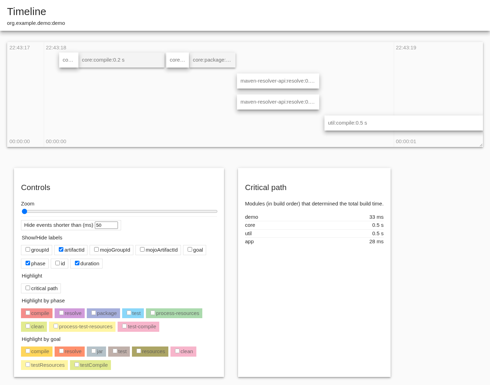

# Takari Maven Timeline

[](https://search.maven.org/artifact/io.takari.maven/maven-timeline)
[](https://github.com/takari/maven-timeline/actions/workflows/ci.yml)
[](https://github.com/jvm-repo-rebuild/reproducible-central/blob/master/content/io/takari/maven/maven-timeline/README.md)

## How to generate a timeline for your project

A tiny, minimal overhead extension to create build metrics and timeline for projects being built. 

Runtime requirement is Java 8 and Maven 3.6+.

To generate a timeline for your project add this to the `build` section of your `pom.xml`, or (recommended), create file `.mvn/extensions.xml` in project root with contents as below:

```xml
<?xml version="1.0" encoding="UTF-8"?>
<extensions>
  <extension>
    <groupId>io.takari.maven</groupId>
    <artifactId>maven-timeline</artifactId>
    <version>2.1.0</version>
  </extension>
</extensions>
```

Once your project has run you will have a `target/timeline/timeline.html` in the top-level of your project. The output will look something like the following:



The report is a single self-contained HTML file (no CDN or network access needed), so it can be archived as a CI
build artifact and opened later. It shows:

* one track per thread (hover a track, or see "Summary by track", for the thread name),
* failed mojos outlined in red,
* the **critical path**: the chain of modules that determined the total build time in a parallel (`-T`) build,
  with a toggle to highlight it on the timeline,
* summaries by phase, goal, artifact and track (click a card title to sort by name or duration).

Events shorter than 50 ms are hidden by default; change this with the "Hide events shorter than" control.

## Configuration

Use following properties:

* **Java System Property** `maven-timeline.enabled` to enable or disable Timeline creation and export, default is `true`.
* Maven Config Property `maven-timeline.discriminator` that moves the `outputDirectory` (default is build directory, ie `target/`) with specified discriminator, default is `null` (does not discriminate output).
* Maven Config Property `maven-timeline.metrics.output.file` the output of metrics JSON file, default is top level project `${outputDirectory}/execution-metrics.json`
* Maven Config Property `maven-timeline.timeline.output.file` the output of Timeline (data and HTML/JS), default is top level project `${outputDirectory}/timeline/maven-timeline.js`

The names used up to version 2.1.0, `maven-timeline.metrics.output` and `maven-timeline.timeline.output`, are still accepted.

Note: Java System Properties must be set via `MAVEN_OPTS` or via `.mvn/jvm.config`, while
Maven Config Property can be set via `-D` command line or in `.mvn/maven.config`, see https://maven.apache.org/configure.html

## Building

Build time requirement is Java 17+ and recent Maven (3.9+ recommended).
